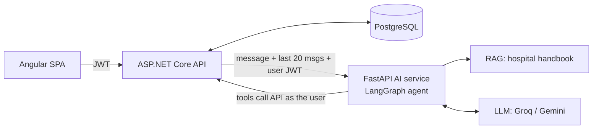

# MediCore — AI-powered Hospital Management System

Full-stack hospital management system with an **agentic AI assistant** that reads live hospital data and takes actions (book, cancel, update) on behalf of the logged-in user, plus **RAG** over the hospital handbook.

| Layer | Tech |
|---|---|
| Frontend | Angular 20 (standalone components, signals, lazy routes, functional guards/interceptors) |
| Backend API | ASP.NET Core 8 Web API, EF Core 8, JWT auth, role-based authorization |
| Database | PostgreSQL |
| AI service | Python FastAPI + LangChain/LangGraph tool-calling agent, Groq (Llama 3.3 70B) or Gemini |
| RAG | fastembed (BAAI/bge-small-en-v1.5) embeddings + cosine search, BM25 fallback |

## Architecture



**Design choices**
- **.NET owns users, data and chat history.** The Python service is stateless; it only reasons and calls tools.
- **The agent calls the API with the user's own JWT**, so it can never see or do more than the user can (a patient can't read another patient's prescriptions even via the chatbot).
- **Role-based toolsets.** Patients get booking tools, doctors get schedule and status tools, admins get stats and search tools.
- **Hybrid assistant.** Live data comes from tools, and policy questions come from RAG. The LLM decides which one to use.
- **Conversation memory.** `Conversations` and `ChatMessages` tables; the last 20 messages are sent as context, and "New chat" creates a fresh conversation.
- **Safety.** The assistant confirms before changing data, never diagnoses, and redirects emergencies to Rescue 1122.

## Features

| Patient | Doctor | Admin |
|---|---|---|
| Browse doctors, book a free 30-min slot | Today's schedule, mark Completed/Cancelled | Stats dashboard (7-day trend, status split) |
| Cancel own appointments | Write prescriptions (auto-completes visit) | All appointments, doctors, patients |
| View prescriptions (printable) | View patients | Activate/deactivate users |
| AI assistant (English / Urdu / Roman Urdu) | AI assistant | AI assistant |

## Run locally

**Prerequisites:** .NET 8 SDK, PostgreSQL, Node 20+, Python 3.11+, and a free [Groq API key](https://console.groq.com/keys).

### 1. Backend (.NET)
```bash
cd backend/MediCore
# edit appsettings.json: DB password + a long random JwtSettings:SecretKey (32+ chars)
dotnet tool install --global dotnet-ef        # once
dotnet ef migrations add AddChatAndAdmin      # creates the chat tables migration
dotnet run --launch-profile http              # http://localhost:5136/swagger
```
On first start it applies migrations and seeds demo data.

### 2. AI service (Python)
```bash
cd ai-service
python -m venv venv
venv\Scripts\activate          # Windows   (macOS/Linux: source venv/bin/activate)
pip install -r requirements.txt
copy .env.example .env         # macOS/Linux: cp .env.example .env  -> paste GROQ_API_KEY
uvicorn app.main:app --port 8000 --reload   # http://localhost:8000/health
```
The first start downloads the embedding model (~130 MB). Set `RAG_MODE=keyword` to skip the download.

### 3. Frontend (Angular)
```bash
cd frontend
npm install
npm start                      # http://localhost:4200
```

### Demo accounts (password `Password@123`)
| Role | Email |
|---|---|
| Admin | admin@medicore.com |
| Doctor | ahmed.khan@medicore.com |
| Patient | patient@medicore.com |

## Try the assistant
- *Patient:* "Find a skin specialist and show free slots for tomorrow" → "Book 11 AM" → "yes"
- *Patient:* "Mera agla appointment kab hai?" / "Can I pay with Easypaisa?"
- *Doctor:* "What's my schedule today?" / "Mark appointment 2 as completed"
- *Admin:* "Summarize hospital stats" / "List cancelled appointments"

## API overview
| Area | Endpoints |
|---|---|
| Auth | `POST /api/auth/register`, `POST /api/auth/login`, `GET /api/auth/me` |
| Doctors | `GET /api/doctor?specialization=`, `GET /api/doctor/{id}`, `GET/POST/PUT /api/doctor/profile|myprofile`, `DELETE /api/doctor/{id}` |
| Patients | `GET /api/patient`, `GET /api/patient/{id}`, `GET /api/patient/myprofile`, `POST/PUT /api/patient/profile` |
| Appointments | `POST /api/appointment`, `GET /api/appointment/availability`, `GET /api/appointment[/myappointments|/doctorappointments]`, `PUT /api/appointment/{id}/status`, `DELETE /api/appointment/{id}` |
| Prescriptions | `POST /api/prescription`, `GET /api/prescription/myprescriptions`, `GET /api/prescription/{id}`, `GET /api/prescription/appointment/{id}` |
| Admin | `GET /api/admin/stats`, `GET /api/admin/users`, `PUT /api/admin/users/{id}/toggle` |
| Chat | `GET/POST /api/chat/conversations`, `GET/POST /api/chat/conversations/{id}/messages`, `PUT/DELETE /api/chat/conversations/{id}` |

## Project structure
```
backend/MediCore/     ASP.NET Core API (Controllers, Models, DTOs, Data, Services, Migrations)
ai-service/app/       FastAPI app, LangGraph agent, role-based tools, RAG
ai-service/docs/      Hospital handbook (RAG knowledge base; add more .md files here)
frontend/src/app/     Angular app (core services, layout, pages, shared modals)
```
